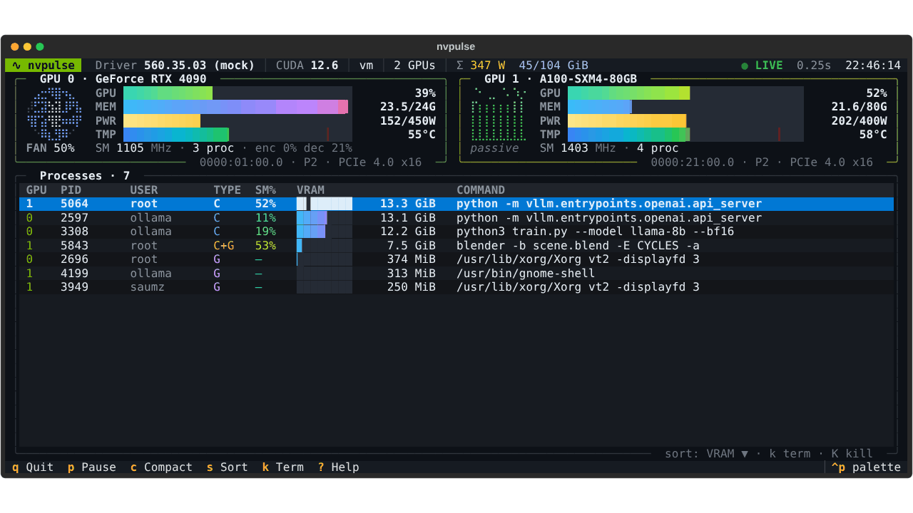
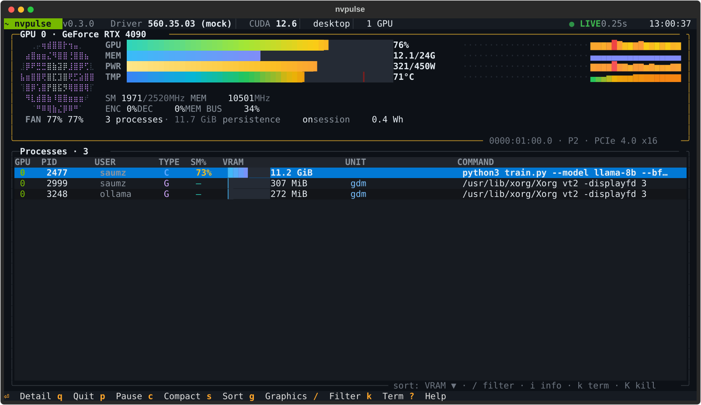
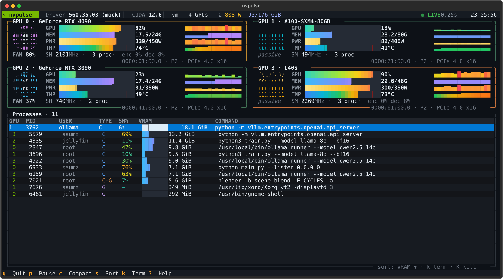
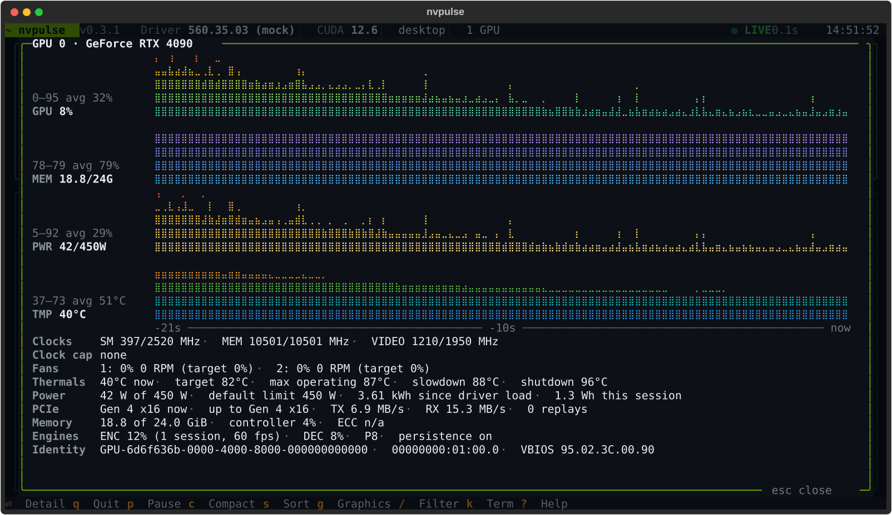
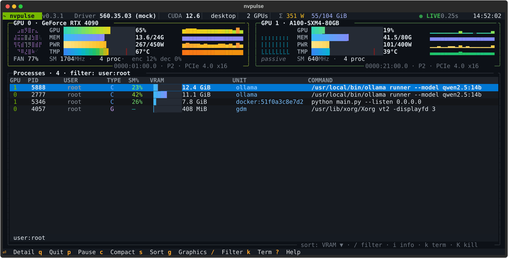

# nvpulse

**An animated, btop-style terminal dashboard for NVIDIA GPUs that launches like `nvidia-smi`.**



`nvpulse` gives you a live view of every GPU in the box: fans that spin at the
card's real fan speed, gradient gauges that ease between samples, a heat bar that
pulses as you approach thermal slowdown, and a sortable process table you can act on.

It also works as a drop-in front end for `nvidia-smi`. Pass it a flag it doesn't
own (`-q`, `-L`, `--query-gpu=…`) or pipe its output, and it hands off to the real
`nvidia-smi` unchanged, so scripts and muscle memory keep working.

> **Status:** alpha (v0.3). Validated on one consumer desktop card so far. Reports
> from laptops, multi-GPU boxes, datacenter cards and WSL are very welcome:
> `nvpulse --dump` prints a snapshot that is safe to paste into an issue.

## Features

- **Animated fans**, drawn procedurally on a braille canvas. Rotation speed tracks
  the reported fan %, with motion blur at high RPM. Passive datacenter cards (A100,
  H100, L40S …) show heatsink fins with rising heat shimmer instead.
- **Gradient gauges** for GPU utilisation, VRAM and power, with 1/8-cell precision
  and eased animation between polls.
- **Heat bar** coloured by absolute temperature, with the driver's slowdown
  threshold marked and a pulsing glow within 10 °C of it.
- **Sparklines** of recent utilisation, memory, power and temperature on wide cards.
- **Process table**: GPU, PID, user, type (C/G), SM %, VRAM bar and command line.
  Sortable and filterable (`/`), with confirmed SIGTERM / SIGKILL, and one key to
  hide the dozens of small graphics clients a desktop session creates.
- **Containers and services**: a UNIT column names the Docker, Podman, LXC or
  Kubernetes container, or the systemd service, that owns each process.
- **GPU detail view** (`Enter`): tall history graphs and every reading the card
  offers, from per-fan RPM and thermal thresholds to PCIe throughput and ECC counters.
- **Warnings where they matter**: a badge on the card when it is thermally or
  hardware throttled, a note when it sits in a slot that limits its PCIe link, and
  optional alerts when temperature or VRAM crosses a limit you set.
- **`nvpulse --once`**: the same numbers as one plain snapshot, for SSH one-liners
  and login banners.
- **Energy and cost**: watt-hours drawn since you started watching, priced at your
  rate if you give one.
- **Adaptive layout**: a large card for a single GPU, a responsive grid for many.
- **nvidia-smi passthrough** for anything non-interactive.
- **Mock mode** (`--mock N`) to try it with no GPU at all.
- **Safe with hostile input**: other users' process names can't inject terminal
  escape sequences, secrets in command lines are masked, and kills are pinned
  to the exact process with a pidfd.

| Single GPU | Multi-GPU |
|---|---|
|  |  |

| GPU detail view | Filter and UNIT column |
|---|---|
|  |  |

## Install

Requirements: Linux, Python 3.10+, and an NVIDIA driver (provides NVML /
`libnvidia-ml.so`). You also need a terminal with 24-bit colour and a font that
has braille glyphs; most modern terminals qualify.

```bash
# straight from GitHub, pinned to a release (see Releases for the latest tag)
pipx install git+https://github.com/jsaumer/nvpulse.git@v0.3.0

# or from a clone of this repo
pipx install .

# or, for development
python -m venv .venv && . .venv/bin/activate
pip install -e '.[dev]'
```

This installs two commands: `nvpulse`, and `nvidia-smi+` as an alias. To move to a
newer release, run the first command again with the new tag and `--force`.
nvpulse is not on PyPI.

## Usage

```bash
nvpulse                    # dashboard
nvpulse -i 0,2             # only GPUs 0 and 2 (UUIDs and PCI bus IDs work too)
nvpulse -n 0.5             # poll every 0.5 s (default 1 s)
nvpulse --compact          # force compact cards (--expanded for the large layout)
nvpulse --no-anim          # static, low-CPU mode
nvpulse --fps 30           # smoother animation (default 20)
nvpulse --mock 4           # four simulated GPUs, no hardware needed
nvpulse --read-only        # disable k/K (good for shared screens or sudo)
nvpulse --no-redact        # show command lines verbatim (secrets are masked by default)
nvpulse --hide-graphics    # start with graphics-only processes hidden
nvpulse --theme mono       # or high-contrast; NO_COLOR=1 also selects mono
nvpulse --once             # print one snapshot and exit (fine in pipes and over SSH)
nvpulse --dump             # one snapshot as JSON, for bug reports (no names or IDs)
```

`--once` looks like this (here with `--mock 2`):

```text
nvpulse v0.3.0   Driver 560.35.03 (mock) · CUDA 12.6 · desktop · 2 GPUs · 2026-10-05 13:00:33

GPU 0 · GeForce RTX 4090   0000:01:00.0 · P2 · PCIe 4.0 x16
  GPU █████████████████████░░░ 89%
  MEM █████████████░░░░░░░░░░░ 12.6/24G
  PWR ████████████████████░░░░ 381/450 W
  TMP ████████░░░░░░░░░░░░░░░░ 44°C   fan 24% 24%

GPU 1 · A100-SXM4-80GB   0000:21:00.0 · P2 · PCIe 4.0 x16
  GPU ██████░░░░░░░░░░░░░░░░░░ 23%
  MEM █████████░░░░░░░░░░░░░░░ 29.1/80G
  PWR ███████░░░░░░░░░░░░░░░░░ 112/400 W
  TMP ██████░░░░░░░░░░░░░░░░░░ 39°C   passive

GPU      PID USER       TYPE  SM%       VRAM UNIT                COMMAND
  1     5223 jellyfin   C     13%   11.4 GiB                     python3 train.py --model llama-8b --bf…
  0     2777 root       C     61%   11.1 GiB ollama              /usr/local/bin/ollama runner --model q…
  1     4650 saumz      C      5%    9.6 GiB                     python3 train.py --model llama-8b --bf…
  1     5346 root       C     12%    7.8 GiB docker:51f0a3c8e7d2 python main.py --listen 0.0.0.0
  0     3208 saumz      C     55%    797 MiB docker:9c41d7e02b6a /app/Tdarr_Node/Tdarr_Node
  0     4057 root       G       —    408 MiB gdm                 /usr/lib/xorg/Xorg vt2 -displayfd 3
```

### Settings file

Defaults you'd otherwise type every time can live in
`~/.config/nvpulse/config.toml`, along with alert limits and an energy price:

```toml
interval = 0.5
hide_graphics = true

[alerts]
temp = 85      # °C
vram = 95      # percent

[energy]
cost_per_kwh = 0.30
```

Flags always win over the file, in both directions (`--no-hide-graphics`,
`--no-read-only`, `--anim`, `--redact`). Every setting is listed in
[docs/configuration.md](docs/configuration.md).

```bash
nvpulse --no-config        # ignore the settings file for this run
```

### Passthrough to nvidia-smi

```bash
nvpulse -q                                              # forwarded
nvpulse --query-gpu=name,temperature.gpu --format=csv   # forwarded
nvpulse | cat                                           # stdout not a TTY: forwarded
nvpulse --classic                                       # plain nvidia-smi table
```

The real binary is found on `PATH`, skipping nvpulse itself. To point at a
specific binary, set `NVPULSE_REAL_SMI=/usr/bin/nvidia-smi`.

If you want nvpulse to *be* `nvidia-smi` in your interactive shell:

```bash
alias nvidia-smi='nvpulse'
```

### Keys

| Key | Action |
|---|---|
| `q` | Quit |
| `p` / `space` | Pause or resume polling |
| `+` / `-` | Poll faster / slower |
| `c` | Toggle compact / expanded cards |
| `a` | Toggle animation |
| `s` | Cycle process sort: VRAM → SM % → PID → GPU → UNIT |
| `g` | Hide or show graphics-only processes |
| `/` | Filter processes: plain text, or `user:name`, `gpu:0`, `unit:docker`, `pid:1234`, `type:c`. `Enter` keeps the filter, `Esc` clears it |
| `i` | Full details of the selected process, including the whole command line |
| `Enter` | GPU detail view for the selected process's GPU (or click a card); `←` `→` switch GPU, `Esc` closes |
| `k` / `K` | SIGTERM / SIGKILL the selected process (asks first) |
| `↑` `↓` | Move in the process table |
| `?` | Help |

You can only signal processes you're allowed to signal. nvpulse doesn't need root,
and running it as root is discouraged; if you do, the header shows a **ROOT**
badge and `--read-only` is a good idea. See [Security](docs/security.md).

## Documentation

- [Architecture](docs/architecture.md): how the pieces fit together
- [Configuration](docs/configuration.md): the settings file, themes and alerts
- [Roadmap](docs/roadmap.md): what's planned next
- [Troubleshooting](docs/troubleshooting.md): NVML errors, containers, WSL, fonts
- [Security model](docs/security.md): threat model and hardening ([report a vulnerability](SECURITY.md))
- [Contributing](CONTRIBUTING.md): dev setup, tests and conventions
- [Changelog](CHANGELOG.md)

## Related projects

nvpulse sits alongside some excellent tools. If you want something battle-tested
today, try one of these:

- [nvitop](https://github.com/XuehaiPan/nvitop): full-featured interactive NVIDIA process viewer
- [nvtop](https://github.com/Syllo/nvtop): htop-style monitor for NVIDIA, AMD and Intel GPUs
- [gpustat](https://github.com/wookayin/gpustat): compact one-shot GPU status
- [btop](https://github.com/aristocratos/btop): system monitor with GPU panels

nvpulse focuses on animated visuals and on acting as a drop-in `nvidia-smi` front end.

## License

[MIT](LICENSE). NVIDIA, CUDA and nvidia-smi are trademarks of NVIDIA Corporation.
This project is independent and is not affiliated with or endorsed by NVIDIA.
